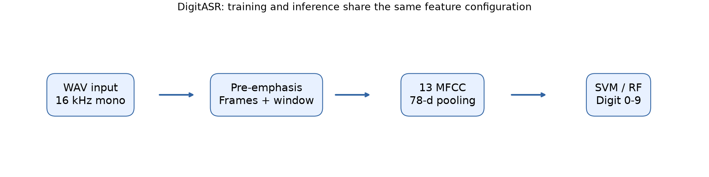
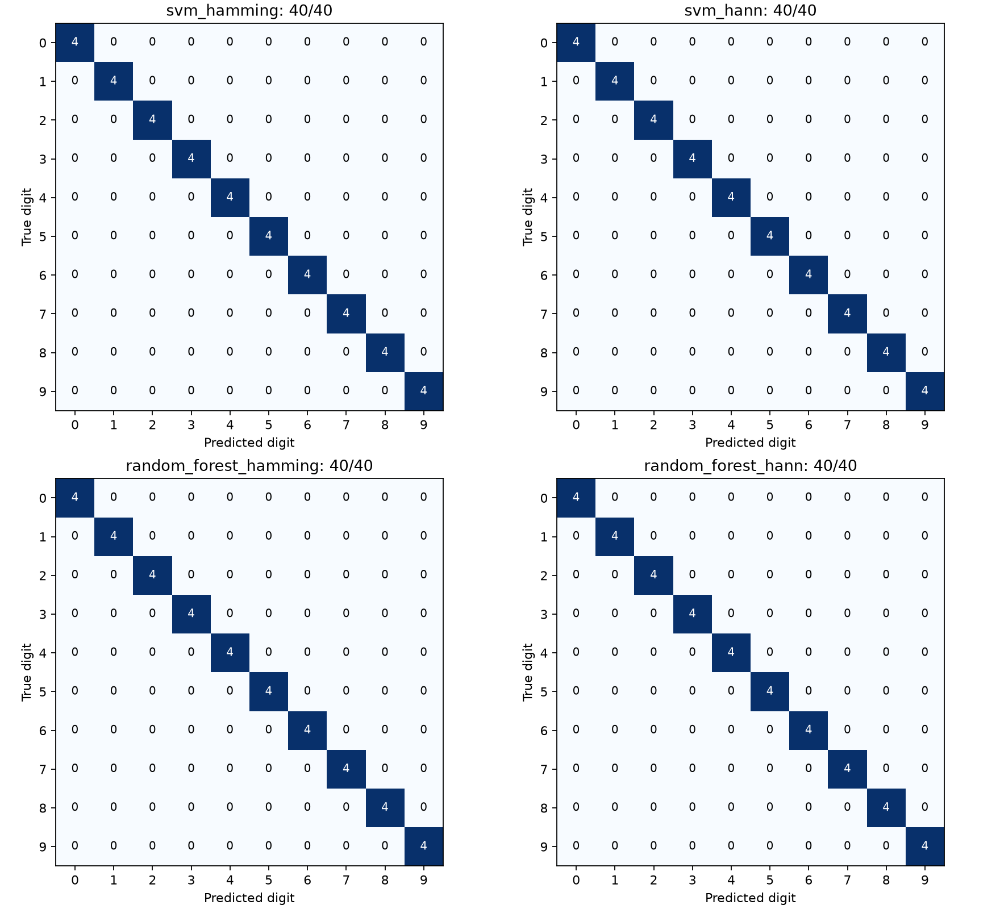
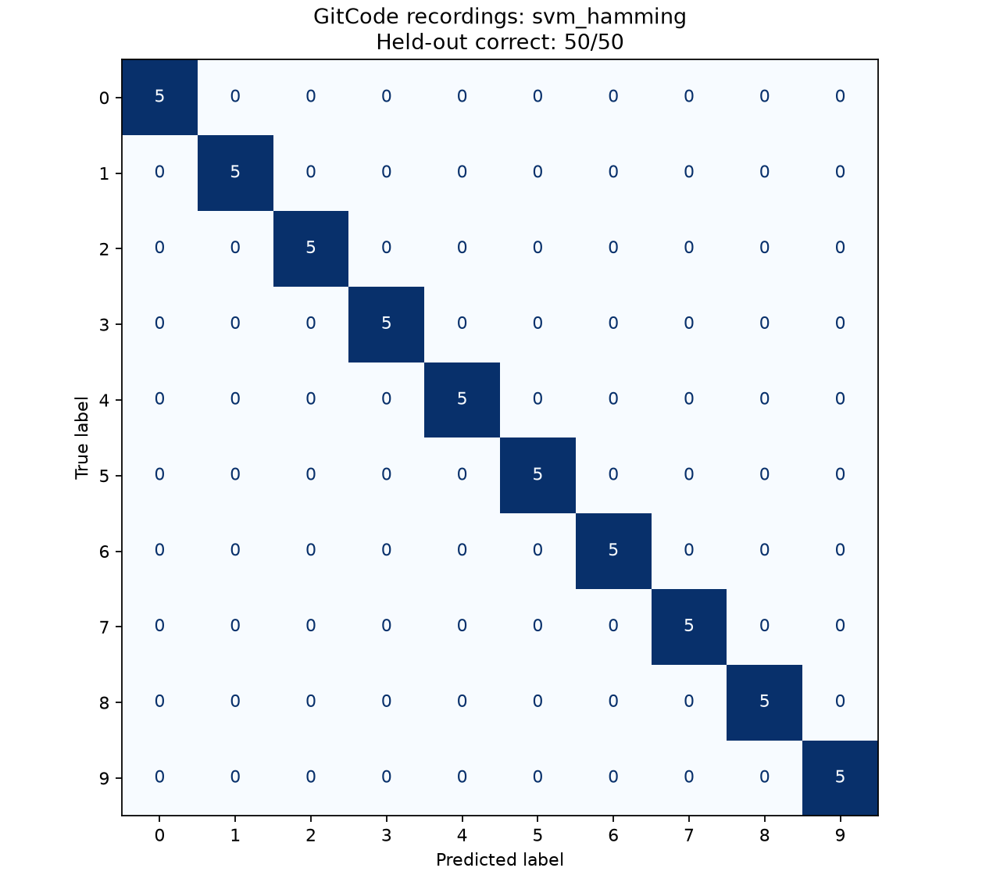

# DigitASR


面向中文孤立数字（0–9）的开源 Python 工具箱：从 WAV、预处理和 MFCC，到模型训练、
评估与 Gradio 交互演示。适合学习经典语音识别流程和替换自己的录音语料。

English brief: A modular, reproducible Chinese isolated spoken digit recognition toolbox
with MFCC features, SVM / random forest baselines, and a Gradio demo.



浏览器截图进程被本环境执行策略阻止，提供流水线图替代。Gradio 已启动并通过客户端上传 WAV 完成识别。
徽章表示已配置工作流，远程 CI 尚未执行。

## 特性

- WAV 输入、重采样、预加重、分帧与 Hann/Hamming 两种窗函数。
- MFCC 与时间分段汇聚；SVM 和随机森林，训练/推理共用特征配置。
- 固定分组划分、数据内容指纹、准确率、混淆矩阵和逐数字分类报告。
- 120 条可溯源中文数字合成样例；另支持本地下载的 250 条受限真实录音及分层评估。
- 可编辑 Python 包、命令行、Gradio 上传/录音 Demo、pytest 与 ruff CI。

## 快速开始

在项目根目录使用 Python 3.10+。Windows PowerShell：

```powershell
python -m venv .venv
.\.venv\Scripts\Activate.ps1
python -m pip install -e ".[dev,demo]"
python scripts/run_experiments.py
digit-asr data/samples/test/0_profile08.wav --model artifacts/svm_hamming/model.joblib
python demos/app.py
```

若 PowerShell 不允许激活，将每条 `python` 换成 `.\.venv\Scripts\python.exe`；
识别可使用 `.\.venv\Scripts\python.exe -m digit_asr.pipeline 音频路径 --model 模型路径`。
Linux/macOS 的激活命令是 `source .venv/bin/activate`，其余 Python 命令相同。
首次安装需要网络，安装后可用本地样例训练与推理。无需 Git、GPU 或在线 ASR 服务。

`run_experiments.py` 训练并评估全部四组模型，在 `artifacts/` 保存模型，
在 `reports/` 写入可核验指标。重复运行会更新这些生成产物。
Demo 浏览器地址默认 `http://127.0.0.1:7860`，可用 `--port` 更改端口。

只训练和评估单一模型：

```powershell
python scripts/train.py --model svm --window hamming
python scripts/eval.py --model artifacts/svm_hamming/model.joblib
python -m pytest -q
python -m ruff check .
```

Python API：

```python
from digit_asr.pipeline import DigitRecognizer

recognizer = DigitRecognizer("artifacts/svm_hamming/model.joblib")
digit = recognizer.predict("data/samples/test/0_profile08.wav")
print(digit)
```

## 流水线

WAV → 单声道/16 kHz → 首尾近静音裁剪/峰值归一化 → 0.97 预加重 →
25 ms 分帧/10 ms 帧移 → Hann 或 Hamming → 512 点 FFT → 40 mel 滤波器 →
13 MFCC → 全句均值/标准差 + 四段均值（78 维）→ SVM 或随机森林 → 数字。

SVM 的标准化仅在训练集拟合；保存模型同时保存特征配置。详见
[实现说明](docs/design-notes.md)。只处理一条一个数字，不支持连续数字串。

## 实验结果

### 合成语音结果

| 模型 | 窗函数 | 训练条数 | 测试正确/总数 | 实测准确率 |
|---|---|---:|---:|---:|
| SVM | Hamming | 80 | 40/40 | 100.00% |
| SVM | Hann | 80 | 40/40 | 100.00% |
| 随机森林 | Hamming | 80 | 40/40 | 100.00% |
| 随机森林 | Hann | 80 | 40/40 | 100.00% |

以上为本地虚拟环境实际运行结果。数据是 eSpeak NG 1.52.0 的 cmn 音色合成的 120 条语音，
固定 8 个参数组训练、4 个参数组测试。每类测试 4 条，超参数预先固定，没有测试集调参。
两种窗在当前小样本上没有准确率差异，不能据此判断优劣。合成域内结果不代表真人录音或跨人泛化效果。



行是真实数字，列是预测数字。逐类报告、逐条预测及精确环境版本见 [reports](reports/)，
汇总见 [summary.csv](reports/summary.csv)，验收记录见 [RESULTS.md](RESULTS.md)。
重新绘图：`python -m pip install -e ".[plots]"` 后运行 `python scripts/plot_results.py`。

### 真实录音结果（GitCode）

来源：[Universal-Tool/9baeb：数字0到9的中文发音语音库](https://gitcode.com/Universal-Tool/9baeb)。
下载实得 250 个 WAV，每个数字 25 条，16 kHz 或 22.05 kHz、单声道 PCM16。
上游同时提供 MIT LICENSE 和 README 非商业使用提示；本项目按非商业、禁止再分发管理音频和压缩包。
这些第三方录音不属于项目 MIT 许可的原创样例，不随仓库分发。
`data/external/` 已加入 `.gitignore`，下载包、录音和本地清单均保存在该目录。

无需 Git，使用现有虚拟环境复现：

```powershell
.\.venv\Scripts\python.exe -m pip install -e ".[plots]"
.\.venv\Scripts\python.exe scripts/download_gitcode_digits.py
.\.venv\Scripts\python.exe scripts/run_real_experiments.py
```

加载器按 `zero-1.wav` 至 `nine-25.wav` 的英文数字前缀映射标签，也支持数字命名的类别目录。
固定种子 42，按 SHA-256 分组，用分层 `StratifiedGroupKFold(5, shuffle=True)` 的第一折作测试集：
训练 200 条（每类 20），测试 50 条（每类 5）。原始文件含 10 对字节相同的音频，共 240 个唯一哈希；
重复音频不跨训练/测试或交叉验证折。训练集再做同样按哈希分组的分层 5 折，每折训练 160、验证 40 条。
SVM 标准化仅拟合相应训练折，超参数沿用现有模型；测试集未参与选模。

| 模型 | 窗函数 | 测试正确/总数 | 测试准确率 | 训练集 5 折累计正确/总数 | 5 折均值（原始浮点值） |
|---|---|---:|---:|---:|---:|
| SVM | Hamming | 50/50 | 1.0 | 198/200 | 0.99 |
| SVM | Hann | 50/50 | 1.0 | 198/200 | 0.99 |
| 随机森林 | Hamming | 49/50 | 0.98 | 190/200 | 0.95 |
| 随机森林 | Hann | 49/50 | 0.98 | 188/200 | 0.9400000000000001 |

表中未四舍五入；最后一项保留 NumPy 计算均值的浮点表示，精确计数为 188/200。
按训练集 CV 均值选模，并列时固定优先 Hamming、再优先 SVM，得到 `svm_hamming`。
文件名只有数字词和样本序号，上游没有提供可验证的说话人映射；**无法进行可靠的说话人隔离划分**，
以上结果不代表跨说话人泛化能力。



精确指标、每折结果和选模规则见 [真实数据汇总](reports/real/summary.json)；
划分和哈希见 [split.csv](reports/real/split.csv)，每组的 `metrics.json`、`predictions.csv`、
`cv_predictions.csv` 和 `confusion_matrix.csv` 均在 `reports/real/`。
真实录音训练模型单独保存在 `artifacts/real/`，不覆盖合成模型。
现有 `train.py`、`eval.py` 可直接使用 `--manifest data/external/gitcode_digits/manifest.csv`；
输出模型时指定 `--output artifacts/real/自选名称/model.joblib`。

## 目录结构

```text
src/digit_asr/     preprocess / features / models / evaluate / pipeline / dataset
scripts/          train.py / eval.py / run_experiments.py / generate_samples.py
demos/app.py      Gradio 演示
tests/            信号处理、特征、数据边界、模型保存/推理与指标测试
data/samples/     WAV、清单、数据来源与合成参数
data/external/    本地第三方受限数据（已忽略，不分发）
reports/          实测指标、混淆矩阵、逐条预测、环境版本
docs/             原始设计、实现说明
.github/workflows/ci.yml
```

## 贡献与自己的录音

提交改动前运行 `python -m ruff check .` 和 `python -m pytest -q`。
新增模型请保持训练/预测接口一致；变更特征应重新训练。
录制、清单字段和划分方法见 [录制指南](scripts/record_guide.md)。
默认模型仍由合成语音训练；真实录音模型请显式选择 `artifacts/real/` 下的模型。
GitCode 数据集的实测结果见上文；自录语音和跨说话人效果需要独立评估。
只加载可信来源的 joblib 模型文件。

## 致谢与协议

感谢 NumPy、SciPy、librosa、SoundFile、scikit-learn、Gradio 和 eSpeak NG。
项目代码与原创样例采用 [MIT License](LICENSE)。可选合成工具及第三方依赖各自遵循
原许可证，详见 [样例来源](data/samples/README.md)。
