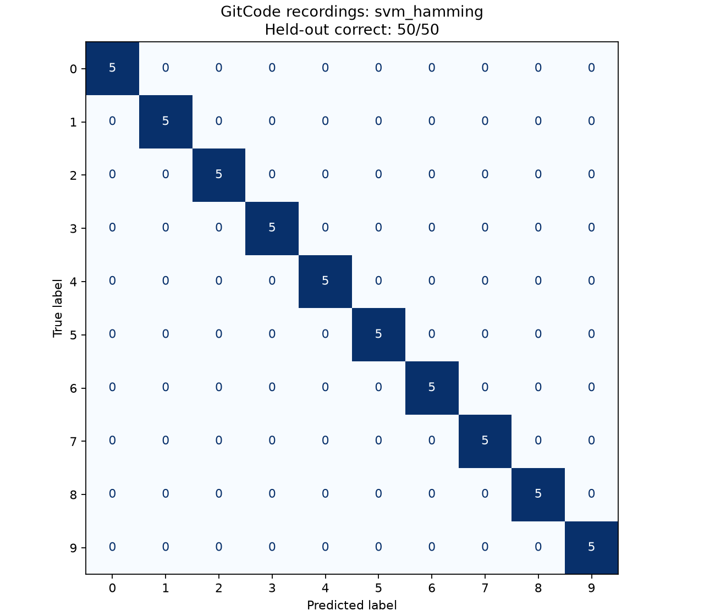

# DigitASR 实测与交付记录

日期：2026-11-04。本地 Windows，Python 3.14.7，项目内 `.venv`。

## 已实现

- M1：src 包、WAV 读取/重采样、归一化、预加重、分帧、Hann/Hamming 加窗、MFCC 和时间汇聚、训练/预测接口、pytest。
- M2：SVM 与随机森林，训练/评估脚本，固定分组划分、内容指纹、准确率、逐类报告、混淆矩阵和逐条预测 CSV。
- M3：Gradio 上传/录音及模型切换，中文 README、MIT LICENSE、.gitignore、运行 ruff/pytest 的 GitHub Actions。
- 图片：docs/images/confusion_matrices.png、docs/images/pipeline.png。

## 合成数据

120 条原创中文数字合成语音：零至九各 12 条，16 kHz、单声道、PCM16。
eSpeak NG 1.52.0 / espeakng-loader 0.2.4 / cmn 共振峰合成音色。
固定 12 个语速/音高参数组：8 组训练（80 条），4 组测试（40 条）。
每条直接合成；同一参数组不跨集。数据来源、许可、全部参数和逐条哈希见
data/samples/README.md、provenance.json、manifest.csv。

## 合成语音实际测量

| 模型 | 窗函数 | 训练条数 | 测试正确/总数 | 准确率 |
|---|---|---:|---:|---:|
| SVM | Hamming | 80 | 40/40 | 1.0（100.00%） |
| SVM | Hann | 80 | 40/40 | 1.0（100.00%） |
| 随机森林 | Hamming | 80 | 40/40 | 1.0（100.00%） |
| 随机森林 | Hann | 80 | 40/40 | 1.0（100.00%） |

SVM：训练集拟合 StandardScaler + RBF SVC，C=10、gamma=scale。
随机森林：200 棵树、种子 42、单线程。所有实验的超参数预先固定，没有测试集调参。
数据指纹：`07377a3ded200375d503afc3ffcf1cbfb4a9957c772f94eab0b7fab13404d17b`。

每类测试 4 条，各组混淆矩阵对角线均为 4，其余为 0。当前样例共享同一合成器与音色，
参数组不代表真实说话人；100% 只验证合成域内流程，不代表真人识别或跨人泛化准确率。
两种窗在本样例上没有准确率差异，不能据此判断优劣。

可核验文件：reports/summary.csv、各模型目录的 metrics.json、predictions.csv、
confusion_matrix.csv，精确依赖版本见 reports/environment.json 和 requirements-local.txt。
四个可加载模型保存在 artifacts/。

## 真实录音数据与实测结果

来源：[Universal-Tool/9baeb](https://gitcode.com/Universal-Tool/9baeb)。
通过 [GitCode ZIP 下载地址](https://raw.gitcode.com/Universal-Tool/9baeb/archive/refs/heads/main.zip)
下载并解开仓库内嵌 ZIP，未使用 Git。实得 250 条 WAV，每类 25 条；采样率为 16000 或 22050 Hz，
单声道 PCM16。加载时统一使用原有 16 kHz 特征流程。
文件按 `zero-序号.wav` 至 `nine-序号.wav` 映射 0–9 标签。

上游有 MIT LICENSE，但 README 同时要求不用于商业用途、不得非法分发。
本任务采用非商业、禁止再分发的限制；音频、压缩包和本地清单只保存在
`data/external/gitcode_digits/`，整个 `data/external/` 已忽略，不受项目代码 MIT 授权覆盖。
下载包 SHA-256：`83a8cf9020fe593f50eee2e6ecf9ef5f3206e630ebe7b1ee6dd731a9909b7e11`。
本地 `provenance.json` 保留下载来源、哈希与使用限制。

数据审计发现 10 对完全相同的 WAV，共 240 个唯一文件哈希。重复对为：
eight-11/eight-4、five-14/five-7、four-10/four-3、nine-10/nine-3、one-10/one-3、
seven-14/seven-21、six-13/six-6、three-13/three-6、two-25/two-7、zero-22/zero-4。
全部 250 个文件保留，SHA-256 相同的文件必须同组，避免重复音频泄漏。

固定种子 42，`StratifiedGroupKFold(n_splits=5, shuffle=True, random_state=42)`
按标签分层、按音频哈希分组，取第一折作测试集。
实际划分为训练 200 条（每类 20）、测试 50 条（每类 5）。
只在训练集上运行同一规则的 5 折 CV：每折训练 160、验证 40；
各折验证集覆盖训练集一次，音频哈希不跨折。SVM 的 StandardScaler 在每折内部拟合。
超参数保持既有 SVM C=10、RBF、gamma=scale；随机森林 200 棵树、seed=42、单线程。

| 模型 | 窗函数 | 测试正确/总数 | 测试准确率 | CV 第1–5折正确数（各40条） | CV 累计正确/总数 | CV 均值（原始浮点值） |
|---|---|---:|---:|---|---:|---:|
| SVM | Hamming | 50/50 | 1.0 | 39, 40, 39, 40, 40 | 198/200 | 0.99 |
| SVM | Hann | 50/50 | 1.0 | 39, 40, 39, 40, 40 | 198/200 | 0.99 |
| 随机森林 | Hamming | 49/50 | 0.98 | 39, 39, 35, 40, 37 | 190/200 | 0.95 |
| 随机森林 | Hann | 49/50 | 0.98 | 38, 38, 35, 40, 37 | 188/200 | 0.9400000000000001 |

全部数字来自实际执行，未四舍五入。随机森林 Hann 的 NumPy 均值原样保留；
精确累计计数为 188/200。每折准确率可由表中正确数除以 40 精确得到，JSON 中也保存原值。
最高训练集 CV 均值为 0.99，按固定并列顺序（Hamming 优先，再 SVM 优先）选中 SVM + Hamming。
测试集未用于选模；其混淆矩阵每个对角线元素为 5，其余为 0：



无法执行可靠的说话人隔离划分：文件名仅为数字词加 1–25 的样本编号，目录和说明没有说话人身份信息。
不能把编号假定为说话人。哈希分组只是重复音频隔离，不是说话人隔离；结果不代表跨说话人准确率。

数据清单指纹：`7bd6d32e912f2222e2976eef9c80057c293bfe27454198f1ddd1b7622fecb8ff`。
证据文件：`reports/real/summary.json`、`split.csv`、`environment.json`，以及各组的
`metrics.json`、`predictions.csv`、`cv_predictions.csv`、`confusion_matrix.csv`。
四个模型单独保存于 `artifacts/real/`，合成结果与模型保持独立。

真实数据复现：

```powershell
.\.venv\Scripts\python.exe scripts/download_gitcode_digits.py
.\.venv\Scripts\python.exe scripts/run_real_experiments.py
.\.venv\Scripts\python.exe -m ruff check .
.\.venv\Scripts\python.exe -m pytest -q
```

实际完成 4 次最终训练、4 次测试评估及 20 次 CV 拟合。
本次 ruff：All checks passed；pytest：31 passed in 11.75s。
另用现有 `eval.py` 分别重新加载四个真实数据模型，所得正确数与报告一致；
核对全部 CV 逐条记录，200 条训练样本各验证一次，重复音频哈希不跨折。

## 复现与验证

```powershell
.\.venv\Scripts\python.exe -m pip install -e ".[dev,demo,data,plots]"
.\.venv\Scripts\python.exe scripts/run_experiments.py
.\.venv\Scripts\python.exe scripts/plot_results.py
.\.venv\Scripts\python.exe -m pytest -q
.\.venv\Scripts\python.exe -m ruff check .
.\.venv\Scripts\python.exe demos/app.py
```

实际完成四次训练、四次独立测试评估。pytest 首次完整运行：18 passed in 10.84s。
ruff：All checks passed。Gradio 已在 127.0.0.1:7860 实际启动，客户端上传
test/0_profile08.wav，选择 svm_hamming 返回 0。已修复本机请求经过代理导致启动 502 的问题。
浏览器截图进程被环境执行策略阻止，因此使用流水线图替代截图。
未使用 Git，远程 GitHub CI 尚未运行。
